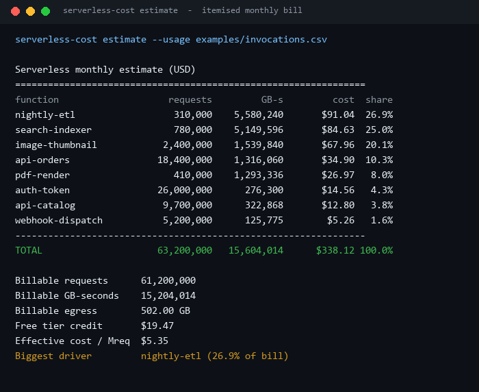
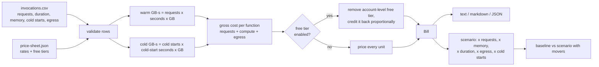
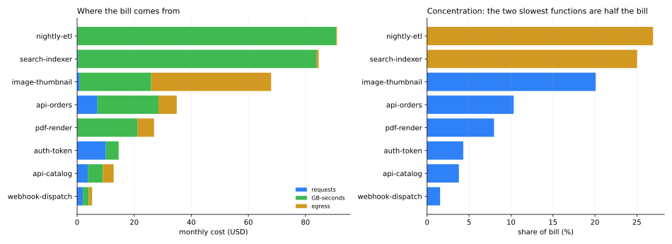
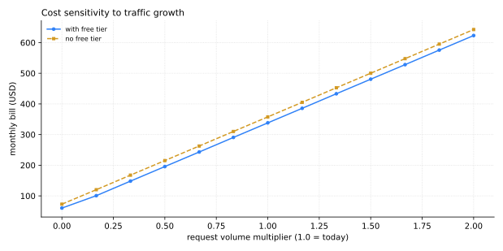

# Serverless-Cost-Modeler

[](https://github.com/abubakarsiddique360/Serverless-Cost-Modeler/actions/workflows/ci.yml)


Give it an invocation CSV - requests, average duration, memory, cold starts, egress - and get the
monthly bill back, itemised per function, with the free tier allocated honestly. Then ask what
happens at double the traffic or with half the memory.

```bash
$ serverless-cost estimate --usage examples/invocations.csv
...
TOTAL                     63,200,000   15,604,014      $338.12 100.0%
Biggest driver         nightly-etl (26.9% of bill)
```

The price sheet is a parameter, not a hard-coded guess. The bundled default is an illustrative
per-request / per-GB-second tariff - replace it before you quote a real number.

## The report



## Why it exists

Serverless bills are easy to generate and hard to explain. The console shows a total, the pricing
page shows a formula with three free tiers, and the question everyone actually asks is "which
function and which change". Spreadsheets answer it once, badly, and then rot.

This tool keeps the whole model in a few hundred lines of standard library Python: one CSV in, one
deterministic bill out, no cloud credentials, no API calls, no rounding drift between the per-line
numbers and the total.

## How the model works



Two details do most of the work:

**GB-seconds.** `warm GB-s = requests × (avg_duration_ms / 1000) × (memory_mb / 1024)`. Cold starts
are not a separate line item: they are additional duration at the same memory size, so
`cold GB-s = cold_starts × (avg_cold_start_ms / 1000) × (memory_mb / 1024)` and both end up in the
same compute charge. That is how the platform bills it, and it means a function with expensive cold
starts cannot hide in the "requests" column.

**Free tier allocation.** The free allowance is an account-level allowance, so it is removed from
the account totals and then credited back to each function in proportion to its gross usage. Every
line's `total` still adds up to the account total, and no function is free by accident of being the
first row in a file. Use `--no-free-tier` to see the raw, unsubsidised bill.

## Cost breakdown



Compute, not request count, decides this bill: `auth-token` serves 26 million requests for $14.56,
while `nightly-etl` spends 18 seconds per invocation on 310 thousand requests and pays $91.04.

## What happens when traffic doubles

`examples/scenario.json` doubles requests and egress, cuts duration by 15% and doubles cold starts:



| Run | Monthly total | Delta |
| --- | ---: | ---: |
| Baseline | $338.12 | - |
| `growth-2x-with-faster-handlers` | $617.81 | +$279.69 (+82.7%) |

| Function | Baseline | Scenario | Delta |
| --- | ---: | ---: | ---: |
| `image-thumbnail` | $67.96 | $137.31 | +$69.34 |
| `nightly-etl` | $91.04 | $156.63 | +$65.59 |
| `search-indexer` | $84.63 | $145.87 | +$61.24 |
| `api-orders` | $34.90 | $65.35 | +$30.44 |

The growth curve is the useful artefact: below 1.0 the free tier hides most of the growth, and above
it the line becomes straight - from that point every 10% more traffic is 10% more bill. Egress has a
knee of its own at the 100 GB allowance.

## Install

```bash
pip install -e .
```

Python 3.10+, standard library only.

## Usage

```bash
serverless-cost estimate    --usage examples/invocations.csv
serverless-cost estimate    --usage examples/invocations.csv --format markdown
serverless-cost estimate    --usage examples/invocations.csv --prices examples/price-sheet.json
serverless-cost estimate    --usage examples/invocations.csv --no-free-tier
serverless-cost compare     --usage examples/invocations.csv --scenario examples/scenario.json
serverless-cost sensitivity --usage examples/invocations.csv --steps 13 --max-multiplier 2
serverless-cost validate    --usage examples/invocations.csv
serverless-cost sheet
```

Exit codes: `0` success, `1` the usage file, price sheet or scenario cannot be used, `2` a numeric
argument is out of range.

## Input formats

`examples/invocations.csv` - one row per function, monthly totals:

```csv
function,requests,avg_duration_ms,memory_mb,cold_starts,avg_cold_start_ms,egress_gb
api-orders,18400000,142,512,9200,2100,64
nightly-etl,310000,18000,1024,60,4000,3
```

| Column | Required | Validation |
| --- | --- | --- |
| `function` | yes | unique, non-empty |
| `requests` | yes | whole number, not negative |
| `avg_duration_ms` | yes | `0 < value <= 900000` (15 minute limit) |
| `memory_mb` | yes | `128 <= value <= 10240` |
| `cold_starts` | no | `0 <= value <= requests` |
| `avg_cold_start_ms` | no | `0 <= value <= 60000` |
| `egress_gb` | no | not negative |

Every bad row is reported with its line number, and all problems are collected before exiting:
`line 4: memory_mb must be between 128 and 10240; line 9: cold_starts cannot exceed requests`.

`examples/price-sheet.json` - any subset of fields, missing ones fall back to the defaults:

| Field | Default |
| --- | ---: |
| `request_price_per_million` | 0.40 |
| `gb_second_price` | 0.0000166667 |
| `egress_price_per_gb` | 0.12 |
| `free_requests_per_month` | 2,000,000 |
| `free_gb_seconds_per_month` | 400,000 |
| `free_egress_gb_per_month` | 100 |
| `minimum_monthly_charge` | 0 |

Unknown fields are rejected on purpose: a typo in `gb_second_price` should not silently become a
default.

## Design notes and limits

- Monthly granularity. If your provider bills per second with a 1 ms minimum, this model is an
  estimate, and the README says so instead of pretending otherwise.
- One region, one price sheet. Multi-region or multi-account bills need a sheet per account and a
  summed run; the JSON output is designed to be concatenated.
- Free-tier allocation is proportional, not chronological. That is the only allocation rule that
  keeps `sum(lines) == total` without inventing an ordering between functions.
- `compare` re-prices both sides, so a scenario that changes memory also changes the free-tier
  allocation - which is exactly the interaction that makes spreadsheet estimates wrong.
- The JSON report embeds the price sheet that produced it, so an archived estimate is reproducible
  after rates change.

## Development

```bash
python -m pip install -e ".[dev]"
ruff check .
pytest                                 # 64 tests, no network access
python scripts/render_assets.py        # regenerate docs/images and docs/*.json
```

## License

MIT - see [LICENSE](LICENSE).
